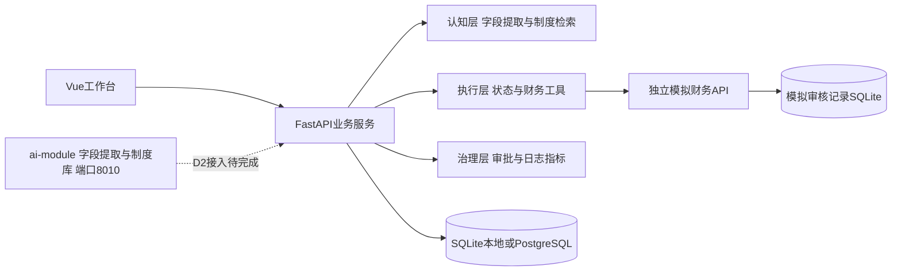

# 架构与开发责任

## 组件与运行形态

| 组件 | 端口 | 数据 | 责任 |
|---|---|---|---|
| `frontend/`（Vue 3 + TS + Vite） | 5173（本地）/ 8080（Compose） | 浏览器草稿 | 员工提交、任务追踪、审批与指标展示 |
| `backend/app/`（FastAPI） | 8000 | `data/tasks.db` 或 PostgreSQL | 鉴权、任务状态机、审批、指标、调用财务与认知层 |
| `backend/finance/`（FastAPI） | 8001 | `data/finance.db` | 预算查询与审核凭证写回，按 `task_id` 幂等 |
| `ai-module/`（独立进程） | 8010 | 制度文档与本地输出 | 字段提取（LLM + 规则双轨）、制度库 16 条、检索方案 |
| `db`（PostgreSQL 17） | 5432（容器网络） | 命名卷 | Compose 模式下的业务库 |

启动约定、环境变量与验证命令见 `docs/DEPLOYMENT.md`；字段契约、JSON 列语义、状态机与迁移策略见 `docs/DATA-DESIGN.md`；接口清单见 `docs/API.md`。

## 接口边界

- 认知层返回建议、依据与版本，不决定是否跳过硬规则。夏一洲在 `backend/app/ai.py` 接入模型，在 `knowledge.py` 扩展检索。
- 执行层使用精确金额，调用预算查询和幂等写回。周勃维护 `services.py`、`schemas.py` 与财务服务。
- 治理层鉴权、待审批状态持久化、日志和指标统一到任务编号。张程量负责接口一致性与数据库演进。
- 员工端与管理台当前放在 `App.vue`，王可、王丹蕊后续按页面拆分组件，共享 `api.ts`。

## 认知层现状与接入边界

当前 `backend/app/ai.py` 是 13 行规则基线：用正则从说明中取唯一金额与唯一类别，返回 `mode=rule_baseline`、`requires_confirmation=true`，识别不到就返回 `None` 而不猜。`knowledge.py` 按类别返回 `data/rules.json` 的 5 条模拟条款（`DEMO-01` 至 `DEMO-05`）。

`ai-module/` 已具备真实模型调用、字段级仲裁、三层降级和 16 条带编号与版本的制度库，但尚未接入业务后端。接入时必须保持现有响应字段不变（`mode`、`suggested_amount`、`suggested_category`、`requires_confirmation`、`message`），并按需追加条款编号、来源、版本与降级标识；模型不可用时回落到规则基线，前端无需改动。这条边界是 D2 的集成前置条件，避免认知层输出格式变更波及员工端与审批台。

## 数据模型

任务表包含确认字段、初审结果、引用条款、工具日志、状态事件、审批记录、人工等待时间和创建结束时间。JSON 字段便于 D1 联调；后续按查询需求拆出独立日志及审批表。模拟财务服务独立保存按 `task_id` 唯一的审核凭证。详见 `docs/DATA-DESIGN.md`。

## 集成验证

- `scripts/smoke.py`：自起自停临时服务与临时库，验证真实 HTTP 链路、唯一任务编号与按编号查询、任务及凭证持久化、提交幂等、预算样例与不扣减、审批续跑、预算拒绝与指标，可作为提交前门禁。
- `scripts/verify_system.py`：对标准端口上真实运行的服务执行 README 六个演示步骤及校验、权限、幂等、指标、工具鉴权共 36 项断言。
- `pytest backend/tests`：流程、权限、边界、异常与幂等，当前 47 项；前端以 `npm run build` 保证类型检查与构建通过。

## 待开发事项

| 负责人 | 下一步 |
|---|---|
| 卢亦楠 | 确认业务规则，维护验收样例、范围和共享看板 |
| 张程量 | 数据迁移、端到端部署验证、执行中断恢复方案、提交并发策略 |
| 王可 | 员工端组件拆分、字段冲突确认、交互完善 |
| 王丹蕊 | 审批台组件拆分、状态筛选、指标图表和日志可读性 |
| 周勃 | 可控重试、写回对账、任务分页、独立日志表 |
| 夏一洲 | LLM适配、结构化校验、真实检索与评测、提示注入验证 |
| 王欣茹 | UI与浏览器测试、真实进程重启测试、故障注入及课程测试集 |

首版不做资金支付、真实财务系统、多场景或多企业全量集成。所有变更同步产品规则、接口约定和测试。
