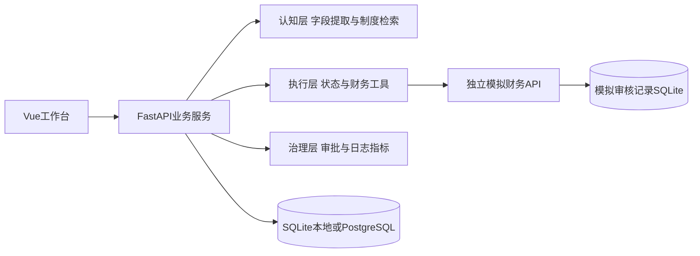

# 架构与开发责任

## 接口边界

- 认知层返回建议、依据与版本，不决定是否跳过硬规则。夏一洲在ai.py接入模型，在knowledge.py扩展检索。
- 执行层使用精确金额，调用预算查询和幂等写回。周勃维护services.py、schemas.py与finance服务。
- 治理层鉴权、待审批状态持久化、日志和指标统一到任务编号。张程量负责接口一致性与数据库演进。
- 员工端与管理台当前放在App.vue，王可、王丹蕊后续按页面拆分组件，共享api.ts。

## 数据模型

任务表包含确认字段、初审结果、引用条款、工具日志、状态事件、审批记录、人工等待时间和创建结束时间。JSON字段便于D1联调；后续按查询需求拆出独立日志及审批表。模拟财务服务独立保存按task_id唯一的审核凭证。

## 待开发事项

| 负责人 | 下一步 |
|---|---|
| 卢亦楠 | 确认业务规则，维护验收样例、范围和共享看板 |
| 张程量 | 数据迁移、端到端部署验证、执行中断恢复方案、提交并发策略 |
| 王可 | 员工端组件拆分、字段冲突确认、交互完善 |
| 王丹蕊 | 审批台组件拆分、状态筛选、指标图表和日志可读性 |
| 周勃 | 可控重试、写回对账、任务分页、独立日志表 |
| 夏一洲 | LLM适配、结构化校验、真实检索与评测、提示注入验证 |
| 王欣茹 | UI与浏览器测试、真实进程重启测试、故障注入及课程测试集 |

首版不做资金支付、真实财务系统、多场景或多企业全量集成。所有变更同步产品规则、接口约定和测试。
