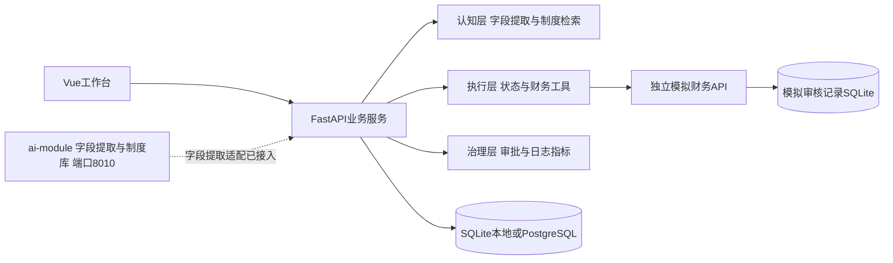

# 架构与开发责任

## 组件与运行形态

| 组件 | 端口 | 数据 | 责任 |
|---|---|---|---|
| `frontend/`（Vue 3 + TS + Vite） | 5173（本地）/ 8080（Compose） | 浏览器草稿 | 员工提交、任务追踪、审批与指标展示 |
| `backend/app/`（FastAPI） | 8000 | `data/tasks.db` 或 PostgreSQL | 鉴权、任务状态机、审批、指标、调用财务与认知层 |
| `backend/finance/`（FastAPI） | 8001 | `data/finance.db` | 预算查询与审核凭证写回，按 `task_id` 幂等 |
| `ai-module/`（独立进程） | 8010 | 制度文档与本地输出 | 字段提取（LLM + 规则双轨）、制度库 16 条、检索方案 |
| `db`（PostgreSQL 17） | 5432（容器网络） | 命名卷 | Compose 模式下的业务库 |

启动约定、环境变量与验证命令见 `docs/DEPLOYMENT.md`；字段契约、JSON 列语义、状态机与迁移策略见 `docs/DATA-DESIGN.md`；接口清单见 `docs/API.md`；D3 集成版本、状态转换、权限矩阵与恢复机制见 `docs/INTEGRATION.md`。

## 接口边界

- 认知层返回建议、依据与版本，不决定是否跳过硬规则。夏一洲在 `backend/app/ai.py` 接入模型，在 `knowledge.py` 扩展检索。
- 执行层使用精确金额，调用预算查询和幂等写回。周勃维护 `services.py`、`schemas.py` 与财务服务。
- 治理层鉴权、待审批状态持久化、日志和指标统一到任务编号。张程量负责接口一致性与数据库演进。
- 员工端与管理台当前放在 `App.vue`，王可、王丹蕊后续按页面拆分组件，共享 `api.ts`。

## 认知层现状与接入边界

认知层由两部分组成：`knowledge.py` 按类别返回 `data/rules.json` 的 5 条模拟条款（`DEMO-01` 至 `DEMO-05`），负责“依据”；`ai.py` 负责“字段理解”，并已按 D2 要求接入 `ai-module`。

`backend/app/ai.py` 现为**适配层**，职责固定为四项，业务判定仍不在此处：

| 职责 | 实现 |
|---|---|
| 启用开关 | 环境变量 `AI_MODULE_ENABLED`（默认关闭，关闭时走内置规则基线，行为与 D1 完全一致） |
| 可达性预检 | 本地模型通道先做 0.4 秒端口预检，失败即改用纯规则配置 `backend/app/data/ai_rule_only.json`，避免按模型通道 120 秒超时阻塞 `/api/parse` |
| 枚举与格式映射 | 按说明内容映射业务类别（交通/车票/机票/高铁等→交通费，住宿/餐饮/招待→其他，办公用品→办公用品）；AI 侧 `expense_type` 仅作辅助，`差旅` 归为其他，实现见 `validation.category_for`；金额统一为两位小数字符串 |
| 契约与降级留痕 | 保持 `mode`、`suggested_amount`、`suggested_category`、`requires_confirmation`、`message` 五个既有字段不变，追加 `ai_enabled`、`source`、`model`、`fields`、`missing_fields`、`patched_fields`、`violations`、`amount_candidates`、`conflicts`、`requires_manual_review`、`fallback_event` |

`mode` 的取值随来源区分：`rule_baseline`（规则基线）、`rule_fallback`（模型不可用降级）、`llm`（模型提取）、`llm_with_rule_patch`（模型提取但个别字段经规则补齐或值被剔除）。`requires_manual_review` 为真时，任务执行会把“模型处理异常，须由审批人核对字段”并入转人工原因，避免降级结果被当作可信数据直接自动通过。

降级链与 `ai-module` 的三层防线对齐：L1 解析容错与 L2 字段级仲裁在其内部完成；L3 整体降级时适配层追加 `fallback_event.trigger`（`llm_preflight_unreachable`、`ai_config_unreadable`、`ai_module_unavailable`），并把业务侧规则基线作为自由文本的兜底来源——`ai-module` 的规则路径以键值对为主，自由文本（如“交通费320元”）提取不到业务字段，兜底后降级体验不会低于未接入。

已知边界：本地模型通道需要 `transformers`/`torch` 环境（`scripts/dev.ps1 ai` 启动，端口 8010），当前开发机未安装，因此实际运行以 `source=rule` 的规则路径与降级路径为准；远程通道（deepseek）的超时由 `ai-module/model_config.json` 控制，启用前须确认该值可接受。制度检索替换（条款级检索）仍在 D3 之后。

## 数据模型

任务表包含确认字段、初审结果、引用条款、工具日志、状态事件、审批记录、人工等待时间和创建结束时间。JSON 字段便于 D1 联调；后续按查询需求拆出独立日志及审批表。模拟财务服务独立保存按 `task_id` 唯一的审核凭证。详见 `docs/DATA-DESIGN.md`。

## 集成验证

- `scripts/smoke.py`：自起自停临时服务与临时库，验证真实 HTTP 链路、解析快照、原子补正、初始请求重放、写回中断检测与 CLI 对账、预算样例与不扣减、审批续跑与指标，可作为提交前门禁。
- `scripts/verify_system.py`：对标准端口上真实运行的服务执行 README 六个演示步骤，以及校验、权限、幂等、指标、工具鉴权、任务编号贯穿与 AI 开关状态共 43 项断言。
- `scripts/verify_integration.py`：D3 集成面 51 项断言，覆盖健康与版本、四类场景事件序列、账号权限矩阵、解析快照与字段冲突、审批补正、指标与任务数据交叉核对、凭证回溯。
- `scripts/verify_restart.py`：真实进程重启 19 项断言，覆盖待审批任务跨重启续跑、幂等重放、执行中任务被标记中断、受限恢复与终态拒绝。
- `scripts/recover_task.py`：受限本机运维入口，只按既有检查点恢复（`replay-writeback` / `retry-budget`），不接受新的审核载荷。
- `pytest backend/tests`：契约、权限、边界、异常、幂等、迁移与 AI 适配层，当前 109 项；前端以 `npm run build` 保证类型检查与构建通过。

集成版本的完整记录（版本标识、权限矩阵、事件序列、恢复机制、实测结果与限制）见 `docs/INTEGRATION.md`。

## 待开发事项

| 负责人 | 下一步 |
|---|---|
| 卢亦楠 | 确认业务规则，维护验收样例、范围和共享看板 |
| 张程量 | D3 已完成集成版本与恢复验证；D4 负责 Compose/PostgreSQL 联调、模型通道联调与固定候选基准 |
| 王可 | 员工端组件拆分、字段冲突确认、交互完善 |
| 王丹蕊 | 审批台组件拆分、状态筛选、指标图表和日志可读性 |
| 周勃 | 补正与故障恢复端到端复测、PostgreSQL兼容验证；分页与自动重试调度按P1后置 |
| 夏一洲 | LLM适配、结构化校验、真实检索与评测、提示注入验证 |
| 王欣茹 | UI与浏览器测试、真实进程重启测试、故障注入及课程测试集 |

首版不做资金支付、真实财务系统、多场景或多企业全量集成。所有变更同步产品规则、接口约定和测试。

## D2/D3业务补强

业务服务新增解析快照表、初始请求快照、具体确认与字段补正记录。创建时先完成身份、解析关联和冲突确认，再落库并执行规则；初审消费服务端模型异常标记，并完整保留转人工原因。审批校验完成后原子保存有效字段、审计记录和running状态，再重新检索与查预算。

写回前持久化原载荷，启动识别中断阶段；受限本机CLI按检查点恢复预算查询或对账写回。无自动重试调度、无普通用户恢复HTTP接口。SQL增量升级、API扩展和实际验证结果见数据设计、接口文档及`周勃-D2开发日志.md`。
