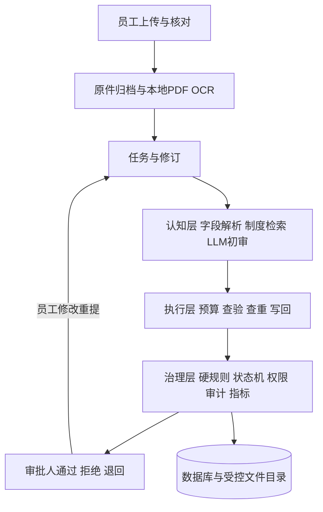

# V0.5 报销数字员工架构

Vue3和TypeScript提供员工报销入口、审批工作台及管理台；FastAPI承载业务与独立模拟财务服务。认知、执行和治理代码分离，当前实现一条报销SOP。

认知层：文字PDF先按位置读取；图片和扫描PDF使用RapidOCR；按原票建议类别、保留全部票面项目，员工核对后确认。AI适配器解析任务字段，reviewer.py再把确认字段、命中条款、工具结果交给实际模型生成结构化初审。两次模型用途分别留证；引用范围、输出格式和不可用降级受控。

执行层：enterprise.py编排步骤，services.py统一工具调用、重试、落日志及最终写回。财务提供预算、模拟查验、重复检查和结果登记接口。原件摘要及票号双重查重，写回以任务幂等。

治理层：企业制度版本不可变、任务绑定版本；金额、预算、重复、无效票据硬约束独立计算。模型意见无法绕过硬约束。未知风险进入人工；审批人可退回，由员工在原任务修订并重新执行，审批字段只读。状态、审批、修订及文件访问可审计。

本机8000业务、8001财务、5173前端，SQLite和受控原件目录持久化，重启保留状态。可选Compose使用PostgreSQL和持久卷；当前电脑Docker/WSL2环境未就绪，容器运行验收待补。复用治理层到其他岗位属于后续设计，本期只交付报销。

最新交互：本张初审在请求中后台继续，前端冻结其载荷并允许切换下一张；后台结果按提交标识更新原条目，草稿及其他任务不受影响。耗时模型调用已移出短数据库修改锁。管理员及approver通过或驳回，驳回回到员工可编辑状态；员工自行撤销。发票上传在写文件及快照前进行内存质量/类型检查。
